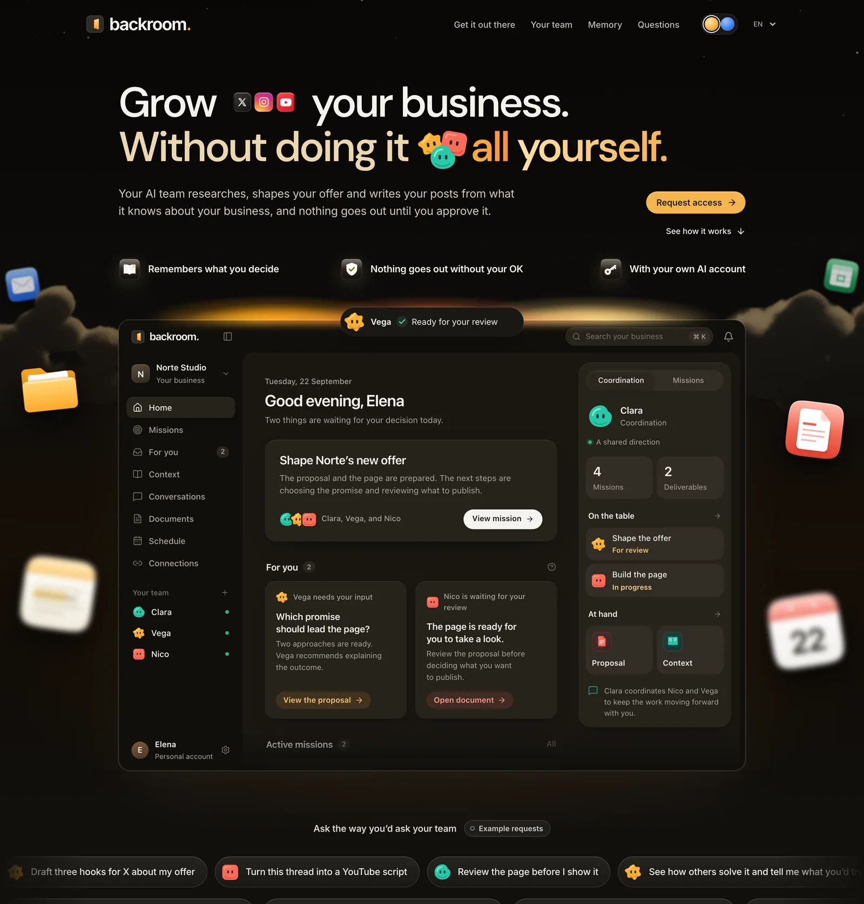
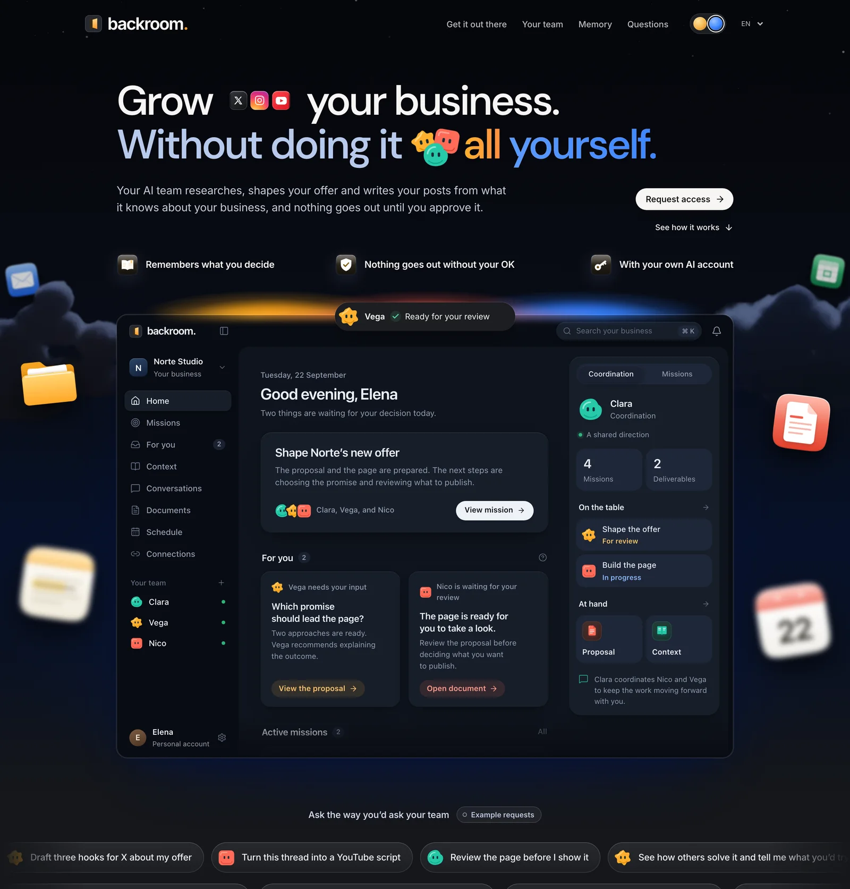
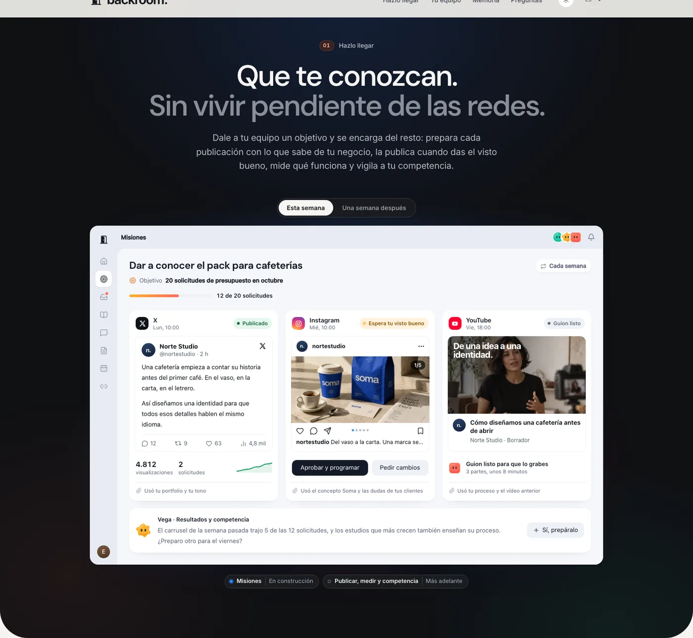
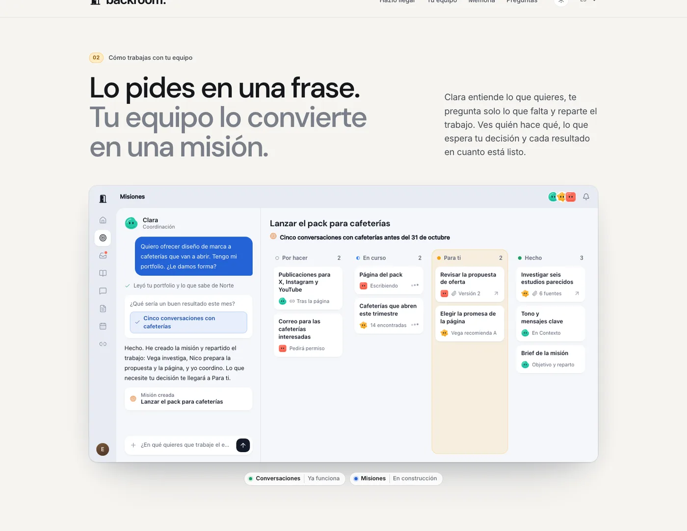

# Backroom

Backroom is an open-source landing page for an AI agent product: a team of agents that runs the work of a small business while the owner decides. It is a Next.js site with a night sky drawn in CSS and WebGL, in two palettes, gold and night blue, four product screens built in HTML instead of screenshots, and copy in Spanish and English.

The product it shows is fictional, and so is every name, number and screen in it. Take the page, change the words and the product, and ship it.





## What is in the page

- **Hero:** a headline with inline icons, three guarantees and a working product window with three views. The sky is an almost empty night lit from the product window, and the clouds are original renders made by a script in this repository.
- **Four sections**, each one a product screen you can click:
  - a distribution mission with posts for X, Instagram and YouTube, which you approve, and a switch to see the results a week later;
  - a conversation that turns a request into a small task board;
  - a memory you correct in one sentence;
  - a phone inbox that asks for permission before anything is published.
- **Questions and a signup form** that sends JSON to any endpoint you choose.
- **Two palettes, gold and night blue,** with a switch in the header, Spanish and English, a pause button for every animation, and no animation when the visitor asks for reduced motion.





## Run it

You need Node 22 or newer and pnpm.

```bash
pnpm install
pnpm dev
```

The page opens at http://localhost:3000 in Spanish, and at /en in English.

## Make it yours

| To change                            | Edit                                                                                                   |
| ------------------------------------ | ------------------------------------------------------------------------------------------------------ |
| Every text on the page               | `messages/es.json` and `messages/en.json`                                                              |
| Where the signup form sends its data | `NEXT_PUBLIC_SIGNUP_ENDPOINT` in `.env.local` (see `.env.example`)                                     |
| Colours of the gold palette          | `modules/home/components/landing-theme.css` and the colours in each stylesheet                         |
| Colours of the night blue palette    | `scripts/palette/blue.mjs`, which writes `modules/home/components/palette-blue.css`                    |
| The sky                              | `modules/home/components/v3/sky.css`                                                                   |
| The clouds                           | `scripts/hero-sky/render.mjs`, then `pnpm render:sky`                                                  |
| The name and logo                    | `modules/home/components/BrandMark.tsx` and the word `backroom.` in the nav, footer and product window |
| Languages                            | `modules/i18n/routing.ts` and one file per language in `messages/`                                     |

Without `NEXT_PUBLIC_SIGNUP_ENDPOINT` the form sends nothing and only shows its success message, so you can try the page before you connect it. With a URL, it sends `{ email, intent, locale }` as JSON, which works with Formspree, a webhook or your own API route.

## How it is built

The site uses Next.js, React, next-intl for the two languages, next-themes for the palette switch and Base UI for the dialogs. The styles are plain CSS files, without Tailwind or a component kit. The page itself starts in `modules/home/components/Landing.tsx`, the four product screens are in `modules/home/components/sections/`, and the hero is in `modules/home/components/v3/`.

The cloud renderer needs Playwright's Chromium, because it draws the clouds with WebGL in a headless browser. The page does not need it, since the rendered images are already in `public/images/landing/`, where a README explains each one.

## License

MIT. The code, the icons, the mascots and the images are free to use in your own projects, including commercial ones.
